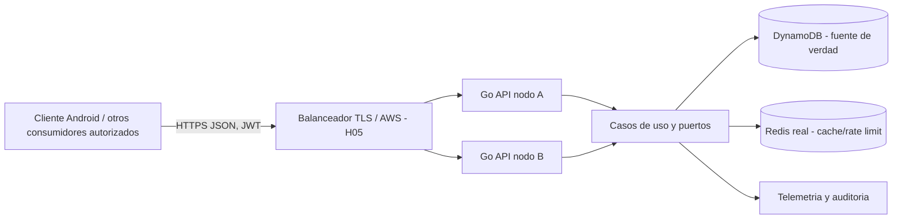

# A-020 — Clean Architecture y modularidad

| Campo | Valor |
|---|---|
| Fase | H04 — Arquitectura general (lote consolidado) |
| Versión | 0.2.0 |
| Estado | **DRAFT — Gate H04 pendiente** |
| Trazabilidad | E001-E075, GOV-05, GOV-11 |
| Proveedor vigente | AWS; DynamoDB NoSQL; Redis real; Backend Go |
| Fuente original | ZIP Android V6.0.2 `(3)`; PDF 75 rutas `(2)`; PDF docente v3 |

## 1. Objetivo y condiciones de aceptación

Esta especificación establece los **requisitos de diseño vinculantes propuestos**, no código implementado. Se rechazan decisiones sin trazabilidad, seguridad o viabilidad. Si contradice `constitution.md`, el Gate se bloquea y se tramita RFC. No crea recursos AWS, endpoints HTTP reales ni modifica cliente móvil.

## Base documental y autoridad

1. Autoridad superior: `constitution.md` v0.2.0, `AGENTS.md`, H03 humano APPROVED (2026-11-05). Ningún texto de esta entrega cambia permisos ni política.
2. Fuente académica: **Requerimientos para el desarrollo del proyecto Móvil v3(2).pdf**, cuatro páginas; requisitos de Backend y dependencias transversales. Se consultó íntegramente en esta entrega.
3. Fuente funcional: **Nexum_V6_0_2_AndroidStudio_Demo_Eliminar_Cuenta(3).zip**, 16 entradas ZIP. Se leyeron `app.js`, `index.html`, `MainActivity.java`, `AndroidManifest.xml`, `README.md` y se comprobó ausencia de `fetch(` en `app.js`. Código cliente no constituye Backend existente.
4. Catálogo: **Nexum_V6_0_2_Catalogo_Completo_Endpoints_Backend(2).pdf**, 27 páginas; 75 identificadores/rutas propuestas E001..E075. Etiquetas M/S/E/O preservadas. **No adoptar** su stack histórico Google Cloud/MongoDB; el stack vigente del proyecto es **AWS + DynamoDB + Redis**.
5. Evidencia H03: 54 decisiones del motor real (53 DENY, 1 ALLOW) y aprobación humana del Gate H03; ejecución en Windows aportada en Warp. En este lote NO se llama a OpenCode y sus permisos siguen restringidos.

**Trazabilidad:** la etiqueta M/S/E/O describe el origen de la ruta, no constituye por sí sola decisión de implementación ni reemplaza lo exigido por el docente. La formalización OpenAPI por ruta y su aprobación corresponde a H06. Las decisiones físicas de despliegue y costo cero corresponden a H05 y no están presumidas.

## 2. Contrato arquitectónico

### 1. Forma del sistema

Monolito modular Go con un único binario Backend replicable en dos instancias simultáneas; no microservicios sin necesidad verificada. Stateless para permitir balanceo sin afinidad de sesiones.

**Regla verificable:** implementar y probar este comportamiento en H08; cerrar el mecanismo de diseño, su riesgo y el contrato antes del Gate correspondiente.

### 2. Capas y dependencia

Domain (entities, value objects, reglas puras) no importa infra; Application (casos de uso y puertos) importa Domain; Infrastructure implementa puertos DynamoDB/Redis/clock/id generator/notification; Transport HTTP convierte DTO y llama Application.

**Regla verificable:** implementar y probar este comportamiento en H08; cerrar el mecanismo de diseño, su riesgo y el contrato antes del Gate correspondiente.

### 3. Módulos de negocio

identity, userprivacy, onboarding, income, movements, recurring, goals, contributions, budgets, analytics, notifications, common; health y catalog como módulos de plataforma. Cada módulo exporta contratos mínimos.

**Regla verificable:** implementar y probar este comportamiento en H08; cerrar el mecanismo de diseño, su riesgo y el contrato antes del Gate correspondiente.

### 4. Topología de paquetes propuesta

cmd/api, internal/domain/{money,identity,finance,...}, internal/application/{...}, internal/ports/{repository,cache,clock,events}, internal/adapters/{dynamodb,redis,mailer,push}, internal/transport/http/{handlers,middleware,dto}, internal/platform/{config,telemetry,shutdown}; internal evita que consumidores usen tipos internos.

**Regla verificable:** implementar y probar este comportamiento en H08; cerrar el mecanismo de diseño, su riesgo y el contrato antes del Gate correspondiente.

### 5. Puertos de repositorio

Interfaces granulares por caso de uso: Users, Sessions, FinancialStore, IdempotencyStore, QueryRepository. La transacción multi-entidad es puerto específico TransactFinance, NO una emulación que componga Put independientes.

**Regla verificable:** implementar y probar este comportamiento en H08; cerrar el mecanismo de diseño, su riesgo y el contrato antes del Gate correspondiente.

### 6. Composition root

Inicialización única inyecta config validada, SDK, caches, repositorios, políticas, handlers y ciclo de vida; fail-fast para secrets/region/identity, readiness condicionado a dependencias.

**Regla verificable:** implementar y probar este comportamiento en H08; cerrar el mecanismo de diseño, su riesgo y el contrato antes del Gate correspondiente.

### 7. Múltiples instancias

Ningún estado de sesión, rate limiting, idempotencia, lock ni agregado crítico en memoria de una réplica. Redis coordina caché y límites; DynamoDB conserva la verdad. Rotación/revocación leíble por los dos nodos.

**Regla verificable:** implementar y probar este comportamiento en H08; cerrar el mecanismo de diseño, su riesgo y el contrato antes del Gate correspondiente.

### 8. Extensibilidad sin inventar

ML/IA generativa del profesor exige una capacidad de producto, pero asignación técnica debe confirmarse sin trasladar toda Mobile al Backend. Definir interfaces de recomendaciones y adaptador proveedor si el flujo elegido requiere API.

**Regla verificable:** implementar y probar este comportamiento en H08; cerrar el mecanismo de diseño, su riesgo y el contrato antes del Gate correspondiente.

## 3. Límites del alcance

- Solamente Backend, datos, seguridad, contratos API e infraestructura gestionada por el equipo Backend; ninguna implementación de Android, landing, Play Store o aprobación del equipo móvil.
- H04 congela **arquitectura lógica**; H05 congela viabilidad y topología física; H06 congela OpenAPI detallado de cada operación; H08 implementa conforme a esas decisiones.
- No convertir opciones propuestas de un catálogo histórico en compromisos silenciosos; no hacer optativas las obligaciones docentes.

## 4. Riesgos específicos y decisiones que deberán sustentarse

- **R-A-020-01:** Ciclos de dependencia entre money y finance.
- **R-A-020-02:** Acceso directo a Dynamo en handlers viola aislamiento y dificulta pruebas.

## 5. Condiciones de aceptación demostrables

- **AC-A-020-01:** Regla de imports por capa validada automáticamente.
- **AC-A-020-02:** Dos procesos independientes sirven la misma identidad y sesiones desde DynamoDB.
- **AC-A-020-03:** Pruebas unitarias sin dependencia nube.

## 6. Trazabilidad y desbloqueo

- H04: aprobar este diseño en conjunto con otros once, sin ocultar discrepancias de fuentes.
- H05: seleccionar recursos AWS permitidos, demostrar costo cero y capacidad para DOS instancias simultáneas + LB/HTTPS + Redis sin simulaciones.
- H06: ratificar las 75 rutas con contratos y categorías M/S/E/O y su cobertura contra pantallas; incluir las operaciones académicas.
- H07: comprobar contradicciones, seguridad, aceptación y que nada indispensable se pospone a implementación por falta de diseño.
- H08: cada caso se implementa y prueba de forma real, aislada, con autorización de release.

## 7. Diagrama lógico

**Nota:** diagrama lógico contractual. Las instancias, LB, DynamoDB y Redis son obligaciones reales; la topología concreta, capacidad, servicio y tarifas se definirán y verificarán en H05. No prueba recursos desplegados.
